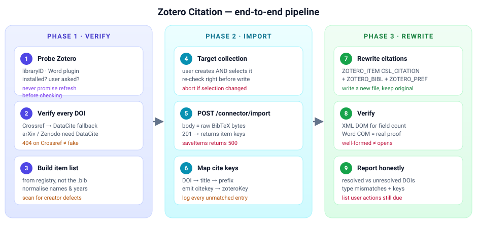
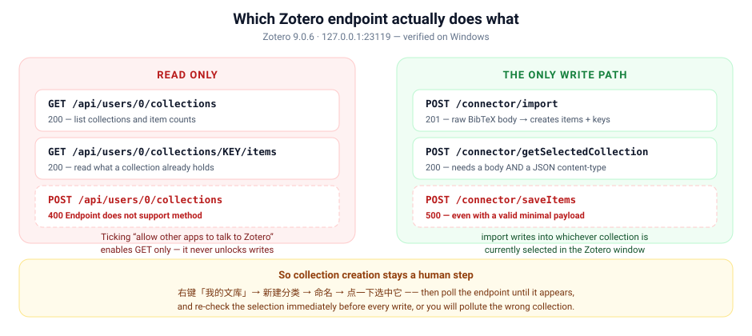
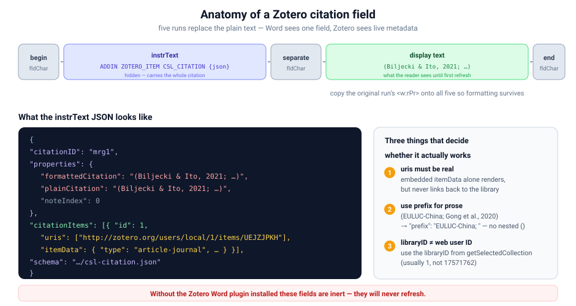

# Zotero Citation

> 把 Word 稿件里"死"的纯文本引用，变成 Zotero 认得、能刷新、能校验的真引用域。
> 附带一套踩坑记录——**Zotero 的本地 API 是只读的**，这件事没有任何文档会告诉你。

[](LICENSE)
[](https://www.zotero.org/)


---

## 这个 skill 解决什么

论文初稿里的参考文献通常长这样：

```
… a land-use judgement derived from a street-view image relies not only on what
the physical scene looks like … (Biljecki & Ito, 2021; Fotheringham et al., 2002).
```

这段是**纯文本**。Zotero 完全认不出来，你也没法：

- 改一条格式 → 全文 38 条都要手动重排
- 换引用样式（APA ↔ Nature）→ 不敢碰
- 确认某条引用到底指向哪篇文献 → 只能靠眼睛
- 审稿人问"这个 DOI 对吗" → 无从查证

这个 skill 把它们替换成真正的 Word 域代码，让 Zotero 接管整份参考文献表。



---

## 先看这个：Zotero 接口的真实情况

大多数人（包括我）第一次都会在这里浪费很久：**勾选了"允许其他计算机上的应用程序与 Zotero 通信"，并不意味着你能写入。**



| 接口 | 方法 | 实测结果 |
|---|---|---|
| `/api/users/0/collections` | `GET` | `200` ✅ 读列表 |
| `/api/users/0/collections` | `POST` | `400 Endpoint does not support method` ❌ |
| `/connector/import` | `POST` | `201` ✅ **唯一可写路径** |
| `/connector/saveItems` | `POST` | `500` ❌ 即使 payload 完全合法 |
| `/connector/getSelectedCollection` | `POST` | `200` ✅ 但必须同时带 Content-Type 和 body |

结论：**建分类这一步永远得由人在 Zotero 界面里点。** 好消息是导入之后全自动。

---

## 生成的引用域长什么样



Word 看到的是"一个域"，Zotero 看到的是"一条带完整 CSL 元数据的活引用"。

---

## 安装

### 作为 Mavis skill 使用

```powershell
git clone https://github.com/haorantang1999/Zotero-citation.git `
  "$env:USERPROFILE\.minimax\agents\mavis\skills\zotero-citation"
```

### 单独使用核验脚本

```powershell
node scripts\verify-dois.js .\references.bib
```

输出每个 DOI 的解析结果、年份、作者，并**单独报告作者名缺陷**：

```
entries: 38  with DOI: 32
OK   Dormann2007            2007   Dormann, Carsten F.       Methods to account for spatial...
OK   BiljeckiIto2021        2021   Biljecki, Filip           Street view imagery in urban analytics...
nodoi Fotheringham2002                                  Geographically Weighted Regression...

--- summary ---
NO_DOI: 6
OK: 32

creator defects: none
```

无第三方依赖，Node 内置模块即可。

---

## 目录结构

```
Zotero-citation/
├── README.md
├── LICENSE                          Apache 2.0
├── SKILL.md                         9 步流程
├── scripts/
│   └── verify-dois.js               Crossref + DataCite 核验（UTF-8 安全）
└── references/
    ├── field-formats.md             域代码 XML/JSON 规格、styleID 推导
    ├── metadata-verification.md     查询顺序 + 8 类元数据陷阱
    └── powershell-traps.md          6 个 PS 5.1 编码陷阱
```

---

## 实战：Mirage2026 稿件

这不是假想的例子，是一次真实运行（38 条文献 / 28 处正文引用）。

**核验结果：32/32 DOI 全部命中真实记录，文献表本身没有造假。** 问题在于它们是死字符。

| 阶段 | 结果 |
|---|---|
| DOI 核验 | Crossref 25 + DataCite 7，32/32 解析成功，6 条无 DOI 逐条对原文确认 |
| 年份校正 | 3 条 `issued` 是 online-first 年，用 `published-print` 修正为版本记录年 |
| 导入 | `/connector/import` → 38 条，21 journalArticle / 8 conferencePaper / 3 bookSection / 1 book / 1 report / 4 document |
| 稿件改写 | 28 个 `ZOTERO_ITEM` + 1 个 `ZOTERO_BIBL` + `ZOTERO_PREF` 锁定 APA 7 |
| URI 绑定 | 58 个 citationItem **全部**带真实 `http://zotero.org/users/local/1/items/KEY` |
| Word 验证 | COM 打开无修复提示，29 个域，渲染文本逐字一致 |

---

## 避坑清单

每一条都是实际踩过的。

### Zotero

- **本地 API 只读**。别把"勾选了那个设置"等同于"我能写"。
- **`saveItems` 返回 500**。`import` 才是可用路径。
- **`getSelectedCollection` 必须同时带** `-H "Content-Type: application/json"` 和 `-d '{}'`，否则分别报 `Content-length not provided` / `Endpoint does not support content-type`。
- **Word 插件是另一回事**。`Zotero.dotm` 随 Zotero 分发，但 `extensions.json` 里没有它就等于没装——域会永远不刷新。
- **BibTeX 转换器没有 `preprint` 路径**。`@misc` 永远变成 `document`，只有 `@online`/`@electronic` 能变 `webpage`。别指望重导一次能修好。
- **`libraryID` ≠ 网页版 user ID**。前者通常 `1`，后者是 `17571762`，引用 URI 用前者。

### 元数据

- **Crossref 会把中间名首字母粘到姓前面**：`family: "F. Dormann", given: "Carsten"`。APA 会渲染成 `(F. Dormann et al., 2007)`。7/17 个作者中招。
- **反向情况也存在**：`family: "Daniel Kissling", given: "W."`。修的时候要排除 `van` / `de` / `der` 等贵族前缀，否则会把 *van der Berg* 改坏。
- **年份看 `published-print`**，不是 `issued`。APA 的 a/b 后缀依赖年份，差一年引用就串了。
- **Crossref 返回 404 不代表假文献**——arXiv(`10.48550`) 和 Zenodo(`10.5281`) 要走 DataCite。
- 其他：全大写姓氏、截断的名（`Stef` → `Stefano`）、系列名混进 `container-title`、标题里的 `<i>` 残留、LaTeX `$\neq$` 残留。

### PowerShell 5.1（Windows 中文环境）

- **无 BOM 的 `.ps1` 按 ANSI 读**。`Bıçakçı` 会变成 `B谋莽ak莽谋` 并被写进 Zotero。用 `[char]0x0131` 拼，或者干脆用 Node。
- **`Get-Content` 不加 `-Encoding UTF8`** 会把 UTF-8 JSON 读坏。用 `[System.IO.File]::ReadAllText($p,[Text.Encoding]::UTF8)`。
- **`Invoke-RestMethod` 访问 Crossref 会失败**，`curl.exe` 正常。这会让人误判成"全部文献都是假的"——这是最糟的错误结论。
- **别用 `Remove-Item`**，权限门会拦。
- **正则会吞掉相邻的域**；`instrText` 有前导空格，`-like 'ADDIN*'` 会静默匹配不到。

---

## 关于引用样式的提醒

APA 7 在**首次刷新**时会改写部分正文引用，这是样式纠正而不是数据丢失：

- `Sun et al., 2026a/b` → `Sun, X., et al., 2026` / `Sun, J., et al., 2026`
- `Wang et al., 2026a/b` → `Wang, J., et al., 2026` / `Wang, Z., et al., 2026`

因为 APA 只在**作者列表完全相同时**才用 a/b，而这些是不同的人。
`De Sabbata et al., 2026a/b` 则符合规则，会原样保留。

---

## License

[Apache License 2.0](LICENSE)